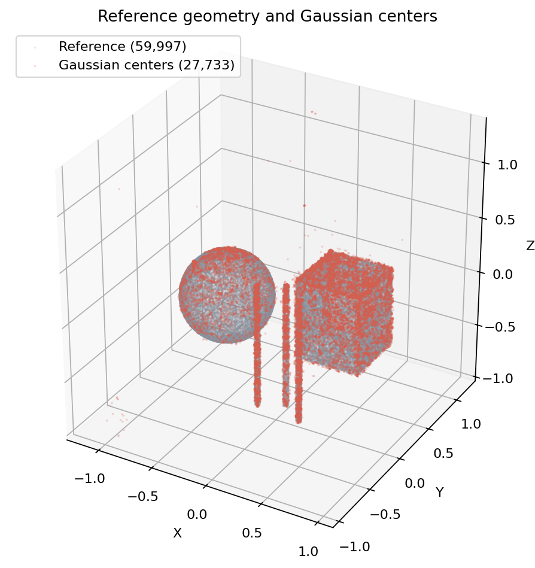
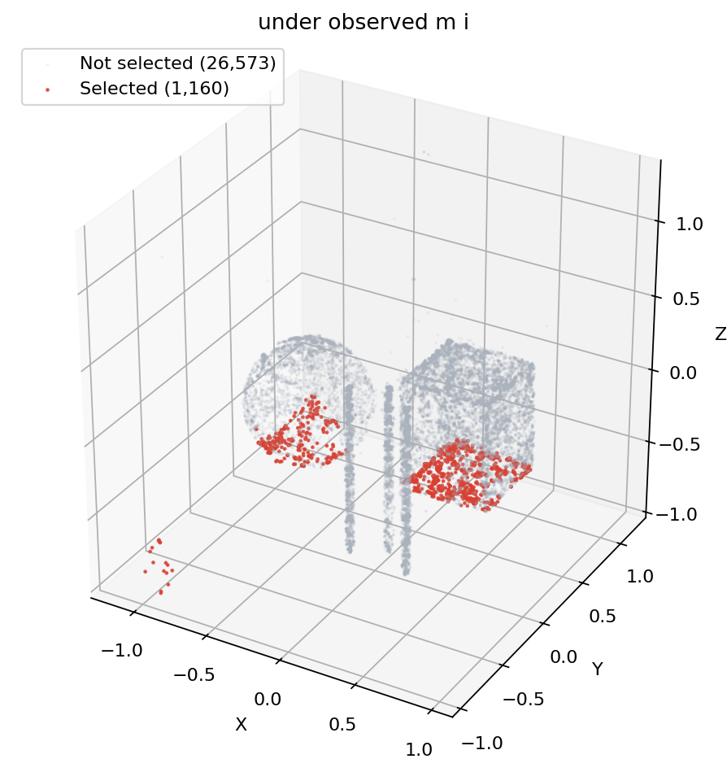
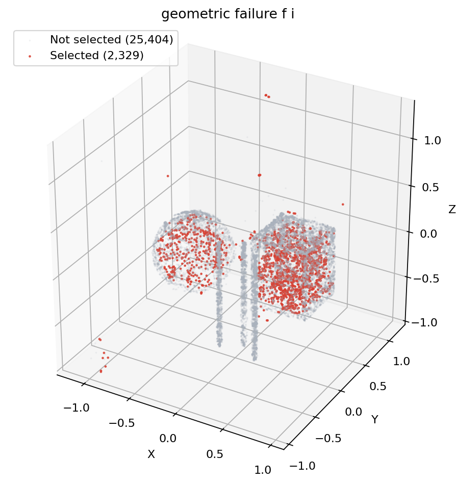
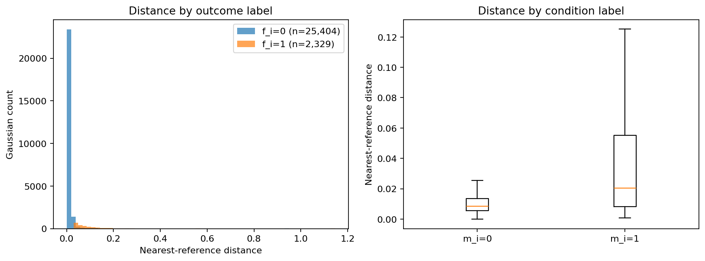

# Geometric benchmark labels — synthetic v8_az360

**Experiment:** tạo continuous geometric error và hai benchmark labels

**Scene:** procedural synthetic

**Condition:** 8 training views / 360° azimuth; 16 held-out views

**Seeds:** 0, 1, 2

**Method:** nearest-reference distance, under-observation proxy và held-out contribution-gated outcome

**Parameters:** `k_views=2`, `theta_deg=10`, `tau=0.03`, `min_contrib=0.01`, `min_opacity=0.05`

## Result

| Seed | N | `m_i` count (%) | `f_i` count (%) | Median `d_i` | P95 `d_i` |
|---:|---:|---:|---:|---:|---:|
| 0 | 27.733 | 1.160 (4,18%) | 2.329 (8,40%) | 0,00850 | 0,07565 |
| 1 | 27.984 | 1.401 (5,01%) | 2.531 (9,04%) | 0,00868 | 0,07643 |
| 2 | 28.691 | 1.396 (4,87%) | 2.467 (8,60%) | 0,00873 | 0,07506 |
| Mean ± SD | — | 4,68 ± 0,44% | 8,68 ± 0,33% | 0,00864 ± 0,00012 | 0,07571 ± 0,00069 |

All checkpoint hashes matched their manifests. Output arrays had the required shapes/dtypes and
contained no NaN/Inf. Benchmark validation completed with **16 tests passed in 14.35 seconds**
on a Tesla T4 using PyTorch 2.11.0+cu130.

## Observation

`m_i` and `f_i` have different prevalence and spatial distributions in every seed. The condition
map concentrates on reference regions with weak camera geometry, while the outcome map covers
Gaussian centers farther from the surface that remain active on held-out views.

Representative seed-0 evidence:

## Interpretation

The observations support keeping under-observation and geometric failure as distinct labels. They
do not establish that under-observation caused each observed failure or that a reliability signal
is faithful.

## Limitations

- `m_i` visibility uses frustum and normal-facing checks without depth occlusion.
- `check_alignment` reports frustum coverage and does not independently verify scale or pose.
- `d_i` is distance to sampled reference points rather than an analytic surface.
- The opacity gate in `f_i` confounds evaluation of an opacity-based signal. `f_i_nogate` awaits
  data-contract approval and D1 integration.
- Experimental evidence in this report covers synthetic `v8_az360`; Blender/DTU are not validated.

## Reproduction

See [the technical report](../../../docs/research/TruongThinh_geometric_failure_research.md#14-reproduction).
Test and environment logs are stored in [`logs/`](logs/).
