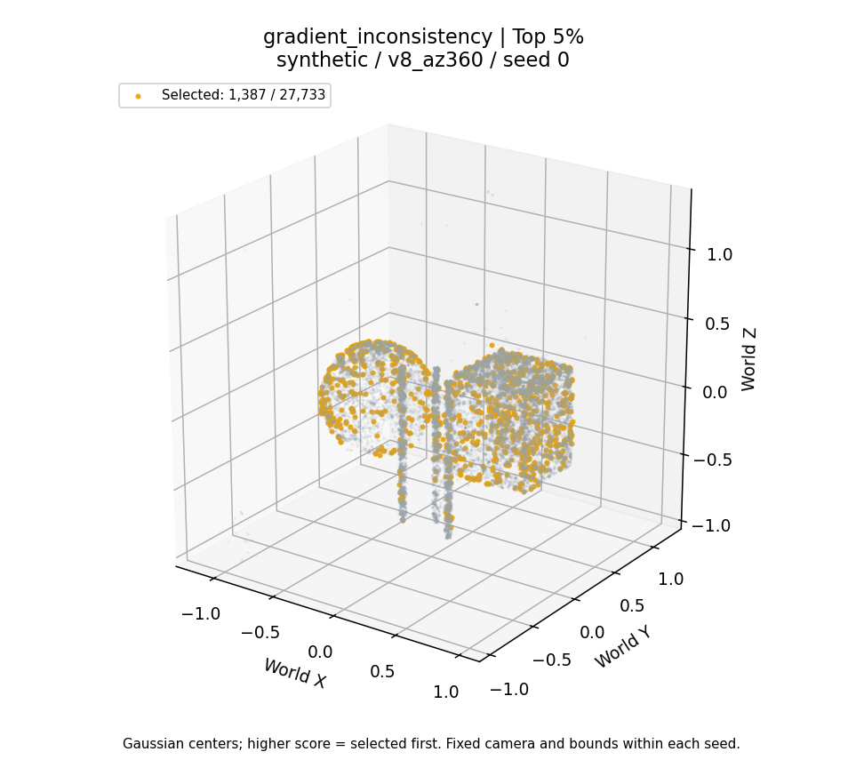

# Quỳnh Anh — signal outputs

Start with [research definitions and reproduce commands](../../docs/research/QuynhAnh_signal_research.md), [experiment audit](QuynhAnh_signal_audit.md), [validation](validation.md), and [implementation notes](../../docs/notes/QuynhAnh_notes.md).

## Files

- `checkpoint_audit.csv`: checkpoint identities and contributing-view counts.
- `reproduction_comparison.csv`: supplied vs recomputed score/ranking comparison.
- `signal_sanity.csv`: exploratory f_i association, Top1/5/10 precision and enrichment; provisional labels only.
- `confounder_checks.csv`: GI vs opacity, visibility and GradMag; denominator diagnostics.
- `phase0_per_seed.csv`: original D2 results, paired with original random removals.
- `recomputed/`: Top1/5/10 scatter figures for opacity, GradMag, visibility, GI and random across three seeds.
- `cached/`: equivalent figures using the four original supplied score vectors.

Large per-Gaussian outputs are gitignored under `runs/signals/`:

| Seed | Recomputed CSV | Cached CSV |
|---|---|---|
| 0 | [signal_results.csv](../../runs/signals/recomputed/synthetic/v8_az360/seed_0/signal_results.csv) | [signal_results.csv](../../runs/signals/cached/synthetic/v8_az360/seed_0/signal_results.csv) |
| 1 | [signal_results.csv](../../runs/signals/recomputed/synthetic/v8_az360/seed_1/signal_results.csv) | [signal_results.csv](../../runs/signals/cached/synthetic/v8_az360/seed_1/signal_results.csv) |
| 2 | [signal_results.csv](../../runs/signals/recomputed/synthetic/v8_az360/seed_2/signal_results.csv) | [signal_results.csv](../../runs/signals/cached/synthetic/v8_az360/seed_2/signal_results.csv) |

Each run also contains scores.npz, rankings.npz, topk.npz, diagnostics.npz, signal_summary.json and a local checkpoint.json. The per-Gaussian score arrays retain checkpoint row order; ranking arrays contain sorted Gaussian IDs.

## Example: GI Top 5%, seed 0

Plots show Gaussian centers in world coordinates, with fixed bounds/camera within each seed; they do not modify opacity or measure rendering influence.
